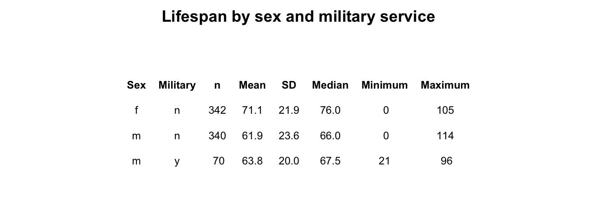
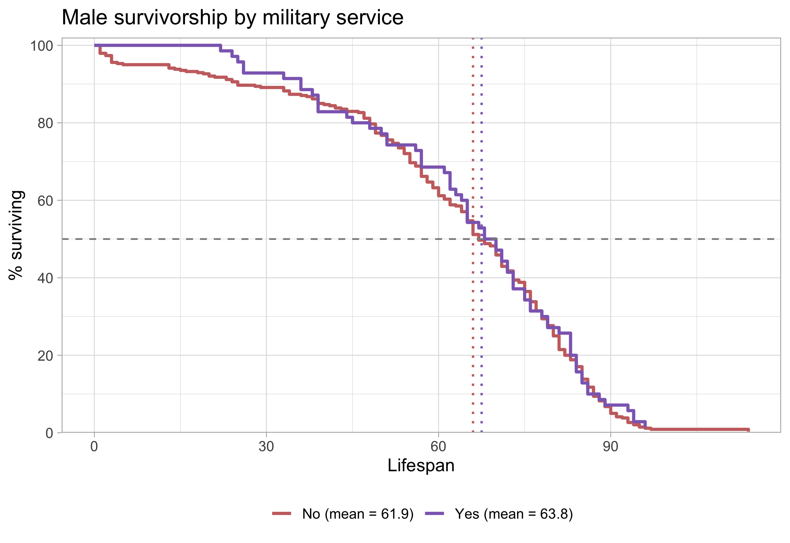

```{=latex}
\onecolumn
\begingroup
\thispagestyle{empty}
\sffamily

% Publication line and journal masthead
\noindent
\begin{minipage}[t]{0.66\linewidth}
  \scriptsize
  Carter and Proctor. \textit{Survivorship Curves of Sunset Hill Cemetery}
  \hfill (2026) 1:1\\
  Valdosta State University, Ecology and Evolution
\end{minipage}
\hfill
\begin{minipage}[t]{0.30\linewidth}
  \raggedleft
  \large Cemetery Demography\\[-2pt]
  \large BIOL 3250
\end{minipage}

\vspace{0.28in}

% Article-type band
\noindent
\colorbox{reportred}{%
  \parbox{\dimexpr\linewidth-2\fboxsep\relax}{%
    \color{white}
    \textbf{RESEARCH ARTICLE}\hfill
    \textbf{CLASS PROJECT}
  }%
}

\vspace{0.18in}

% Title and author line
\noindent
{\fontsize{23}{27}\selectfont
\textbf{Lifespan is Effected by Sex and Marital Status}\par}

\vspace{0.12in}

\noindent
{\small
Brandon Thomas Carter and Proctor\textsuperscript{1,*}
}

\vspace{0.08in}

% Structured abstract
\setlength{\fboxsep}{6pt}
\noindent
\fcolorbox{reportred}{white}{%
  \begin{minipage}{\dimexpr\linewidth-2\fboxsep-2\fboxrule\relax}
    \small

    \textbf{Abstract}

    \vspace{3pt}

    \textbf{Purpose:}
    This project describes lifespan patterns in cemetery records and examines
    variation by sex and marital status. [you can do military service of males or pre- and post- a particular year - default 1930]

    \vspace{3pt}

    \textbf{Methods:}
    Recorded available birth and death information from gravestones
    and classified selected characteristics using evidence visible on the
    stones and in burial arrangements. [Go into much greater detail in the methods section]

    \vspace{3pt}

    \textbf{Results:}
    Summarize the principal patterns in the class data.

    \vspace{3pt}

    \textbf{Conclusions:}
    State what the observed patterns suggest and note limitations. Distinguish
    lifespan in this cemetery sample from population life expectancy.

    \vspace{3pt}

    \textbf{Keywords:}
    cemetery records; lifespan; survivorship; marital status; historical demography
  \end{minipage}%
}

% Bottom-page author and institutional details
\vfill

\noindent\rule{0.56\linewidth}{0.4pt}

\vspace{3pt}

\noindent
{\scriptsize
\textsuperscript{*}Correspondence: bCarter and Proctor@valdosta.edu\\
\textsuperscript{1}Department of Biology, Valdosta State University,
Valdosta, Georgia, USA\\
Ecology and Evolution, BIOL 3250, Section B
}

\vspace{0.10in}

\noindent
\begin{minipage}[c]{0.20\linewidth}
  \includegraphics[width=0.72in]{Valdosta_State_University_seal.png}
\end{minipage}
\endgroup
\twocolumn
```

# Background

Cemetery records provide individual birth and death dates that can be used to describe lifespan among people represented in a burial ground. These records are a non-random sample: cemetery access, preservation of markers, migration, family burial practices, and the choice of graves to record may all affect which people appear in the dataset. The analyses below therefore describe the collected sample and should not be treated as direct estimates of lifespan for an entire town or historical population.

# Hypotheses

3. **Military service and lifespan:** I hypothesize that male records marked as military service will show lower lifespan than records not marked for service because of the draft and exposure to chemicals.


# Methods

## Field site and sampling

- **Where did you go?** We went to the sunset hill cemetary in Valdosta, Georgia next to the VSU campus on Thursday October 8th. We focused on the front of the cemetary and marked names, birth and death dates, maritial status, and if they were in the military or not. 
- **What part of the cemetery did you sample?** We sampled from the south western part of the cemetary. We collected data randomly from the left side of the gate. 
- **How did you choose graves?** We collected data based on trying to have a variety of different results. We made sure to collect some that were married and in the military, as well as, getting roughly an equal amount of males and females.
- **How did you handle nearby graves and family plots?** We sampled randomly to collect data from a broad spectrum. We made sure to collect data of all sorts. We made sure to include some families and single headstones by themselves to ensure there was a variety in our data. 

## Recorded information and variable definitions

- **What information did you record from each marker?** We marked each name, gender, maritial status, birth/death date, and if they were in the military. We also included if there was information on their headstone about them being a higher ranking in the military.
- **How was lifespan calculated?** We did not collect data on headstones that did not have death dates. We subtracted the death date by the birth date to determine the age that each died. 
- **How did you determine military service?** We determined military service of each person by looking for any obvious engraving on the headstones of rankings, wars served in, or military plaques. If there were any information on the headstone regarding a specific ranking we included that information as well (ex. seargants, commanders, etc). 


## Dataset and analysis

- **How many records were collected by you?** [n =50]
- **How many records were included in the final analysis?** We submitted 25 total to the total data set. 
- **Were records aggregated with the class dataset?** No
- **What summaries or plots were produced?** We did notice that we were in a part of the cemetary that contained older headstones. We noticed that most of the individuals that were buried were born mostly in the 1800's signifying that we were in an older part of the cemetary. 
- **What are the limits of the sample?** We came across some limits due to being assigned to a specific part of the cemetary. We could have collected data throughout the entire cemetary and focused on military troops to get more defined data, however we collected it simply on the plot that was given. 

# Results

The summary table in @fig-summary shows substantial differences in recorded lifespan by sex in this sample. Males had a mean lifespan of 59.0 years (SD = 20.4; n = 3), compared with 29.7 years (SD = 7.1; n = 3) for females. The marital-status breakdown is more tentative because each subgroup contains only one or two records. Among males, the two married individuals had a mean lifespan of 70.5 years (SD = 6.4), while the one unmarried individual lived 36 years. Among females, the one married individual lived 36 years, compared with a mean of 26.5 years (SD = 6.4) for the two unmarried individuals. These small subgroup sizes make the values descriptive; they do not support broad conclusions about sex or marital status.

{#fig-summary width=90% fig-pos="t" fig-env="figure*"}

The sex-specific survivorship curves in show a different pattern: the plotted means are 61.1 years for males and 57.3 years for females. The male curve remains higher through much of the earlier and middle lifespan, while the female curve reaches the 50% survival point later. The curves are close and change relative position, so the figure suggests that the sex difference depends on which part of the lifespan distribution is considered. The median markers indicate where each group’s observed curve reaches 50% surviving; they are distinct from the mean values shown in the legend.

{#fig-military width=70% fig-pos="t" fig-env="figure*"}


# Discussion

The data showed that the number of individuals that served in the military did not have as short of a lifespan as I expected. This could be from the area of the cemetary being located in a very rural area where most military troops are buried and honored in bigger cities. Most men that were documented and studied in this curve passed after a time of war or did not simply serve in a time of war. The data ultimately proved my hypothesis to be nulled as it proves that military does not necessarily mean that the lifespan is shorter for those people. 


```{=latex}
\newpage
```

### References

::: {#refs} 
::: 
